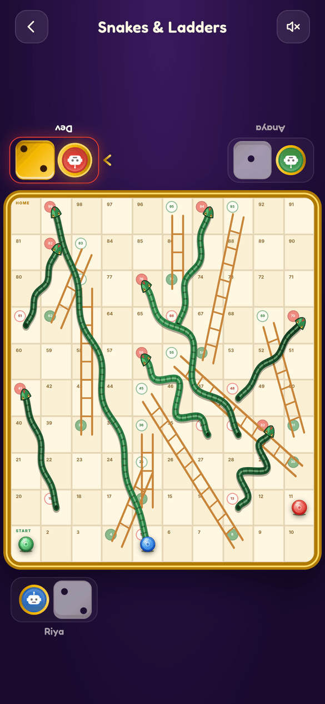
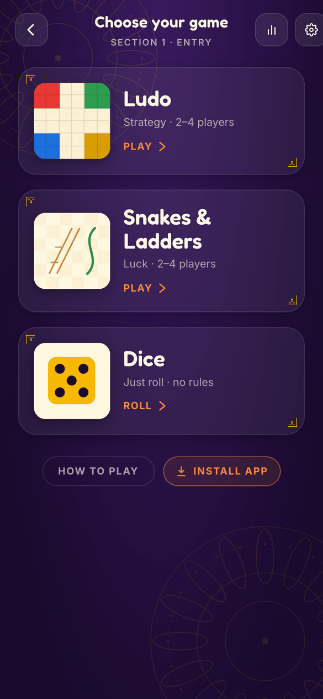
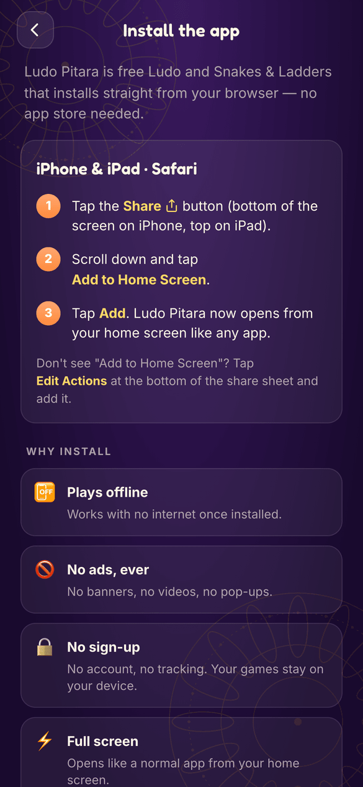

# Ludo Pitara

**Free Ludo, Snakes & Ladders and Dice for your phone. No ads, no sign-up, and it plays offline.**

▶️ **Play now:** https://udeshvirk.github.io/ludo-pitara
📲 **How to install it on your phone:** https://udeshvirk.github.io/ludo-pitara/#/install

<p align="center">
  
  
  
</p>

## Why

Most Ludo apps are full of video ads between turns. Ludo Pitara is the same
classic games with **none of that**:

- 🚫 **No ads, ever.** No banners, no videos, no pop-ups.
- 📴 **Works offline.** After the first visit the whole app lives on your device.
- 🔒 **No account, no tracking.** Games and stats are saved only on your phone.
- 🆓 **Free and open source** under the MIT licence.

## What's inside

- **Ludo** for 2–4 players, against friends on the same phone or against bots
  (easy / medium / hard). Optional rules: start with one token out, first
  token home wins, and **2v2 partner mode**.
- **Snakes & Ladders** for 2–4 players with a new random board every game.
  Optional "start on any roll".
- **Dice**: a plain tap-to-roll die for any board game you own.
- Stats and recent games, sound and vibration toggles, and it adapts to
  phones, tablets and desktop.

## Install it like an app

Ludo Pitara is a web app (PWA). You install it from the browser, with no app
store needed. Once installed it gets its own icon, opens full screen, and
works without internet.

**[Open the step-by-step install guide →](https://udeshvirk.github.io/ludo-pitara/#/install)**
It detects your phone and browser and shows the right steps. Quick version:

| Device | Steps |
|---|---|
| **iPhone / iPad (Safari)** | Tap **Share** → **Add to Home Screen** → **Add** |
| **Android (Chrome)** | Tap **⋮** → **Install app** (or **Add to Home screen**) |
| **Android (Samsung Internet)** | Tap **☰** → **Add page to** → **Home screen** |
| **Computer (Chrome / Edge)** | Click the install icon at the right of the address bar |

> **Opened the link from X, Instagram or Facebook?** Their built-in browser
> can't install apps. Tap **⋯** → **Open in browser** first.

<p align="center">
  
</p>

## Development

React 19 + TypeScript + Vite, Zustand for state, framer-motion for animation,
vite-plugin-pwa for offline support. Sounds are generated in code, so there
are no audio files.

```bash
npm install
npm run dev      # local dev server
npm test         # unit tests (Vitest)
npm run lint
npm run build    # type-check + production build → dist/
```

Every push to `main` is linted, tested, built and deployed to GitHub Pages by
CI (`.github/workflows/ci.yml`).

See [ARCHITECTURE.md](ARCHITECTURE.md) for a tour of the code.

Screenshots are real gameplay captured at phone size. The link-preview card
(`public/og-image.png`) is built from them with `node scripts/gen-og.mjs`.

## License

[MIT](LICENSE)
